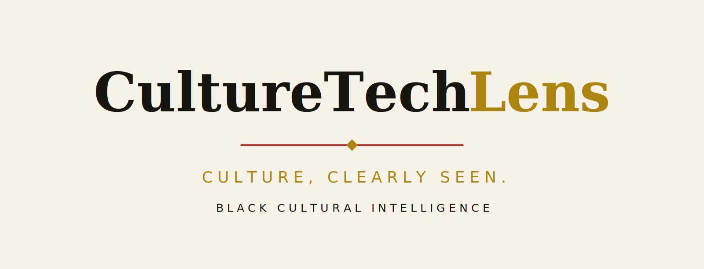

# CultureTechLens Research Repository

<picture>
  <source media="(prefers-color-scheme: dark)" srcset="assets/brand/cornerstone-wordmark-on-dark.png">
  
</picture>

**CultureTechLens (CTL)**  
Public research methodology, source records, datasets, citations, corrections, and revision history.

## Purpose

This repository makes CTL research **inspectable and citable**. It is the public companion to [CultureTechLens](https://culturetechlens.com).

> 🌐 **Website:** [culturetechlens.com](https://culturetechlens.com) · 💛 **Donate:** [culturetechlens.com/donate](https://culturetechlens.com/donate/) · ✉️ **Contact:** [culturetechlens.com/contact](https://culturetechlens.com/contact/)

---

The repository documents how CTL:

- identifies and evaluates evidence;
- distinguishes documented facts from reported claims and analysis;
- records sources and provenance;
- handles uncertainty and conflicting evidence;
- documents corrections and revisions;
- uses structured research records;
- supports reproducible research where legally and technically practical.

## Core documents

- [Papers & public deposits](papers/README.md)
- [Research Methodology](METHODOLOGY.md)
- [CultureTechLens Index research record](RESEARCH/index/README.md)
- [Citation Guide](CITATION.md)
- [Source Register](SOURCES/source-register.csv)
- [Source Register Guide](SOURCES/README.md)
- [Research Projects](RESEARCH/README.md)
- [Data](DATA/README.md)
- [Operational documents](docs/README.md)
- [Corrections](CORRECTIONS.md)
- [Changelog](CHANGELOG.md)

- [Research Briefs](research-briefs/INDEX.md) — the 26 briefs, deposited in the layout the website links to
- [Research Dossiers](research-dossiers/INDEX.md) — the 9 dossiers
- [Flagship Research Packages](research/INDEX.md) — the 14 CTL-DR packages
- [Citation Infrastructure](citation/README.md) — CITATION.cff, BibTeX, CodeMeta, the corpus manifest, Dublin Core

## Methodology version

**Version 1.0 — September 2026**

The methodology is a living document. Material changes are recorded in the changelog.

## Research record

Where appropriate, individual CTL research projects should identify:

1. the research question;
2. the claims being investigated;
3. the sources consulted;
4. the relevant evidence;
5. contextual limitations;
6. the classification of each claim;
7. the interpretation, if any;
8. the publication date and version;
9. corrections or later revisions.

## Transparency

Not every source can be reproduced or republished. Copyright restrictions, privacy, licensing, archival restrictions, and other legal or ethical considerations may limit what CTL can publish. When possible, CTL documents the existence and provenance of restricted material without reproducing it.

## Website

https://culturetechlens.com

Unknowns are never zero: a claim marked UNKNOWN, NOT APPLICABLE, NOT YET RESEARCHED, or NOT PUBLICLY AVAILABLE is a statement about the record, not a gap in it.

## How to cite

Corpus as a whole:

> CultureTechLens NFP, "CultureTechLens Research Corpus," 2026-09-28.

A single package — cite its Research ID and title, e.g.:

> CultureTechLens NFP, "How We Lived: An Encyclopedia of Black Everyday Life (CTL-DR-LIFE-001)," 2026-09-28.

A single claim — cite the claim ID, its grade, and the package, e.g. "per CTL-DR-LIFE-001, CLAIM-012 (VERIFIED)."

## What's not here

Internal build artifacts are intentionally excluded: package `working/` directories, `_tracks/` build tracks, pre-remediation backups, and cross-package audit working files. What ships is the governed package: research, evidence, sources, timelines, red-team findings, and rights logs.

## The record

- **The CultureTechLens Index** — monthly ranking of Black cultural resonance. Edition 2026-10 on Zenodo: [doi.org/10.5281/zenodo.23081630](https://doi.org/10.5281/zenodo.23081630)
- **The Black Cultural Knowledge Graph** — Public Edition (2026-10-06): [doi.org/10.5281/zenodo.23253532](https://doi.org/10.5281/zenodo.23253532) · concept DOI [10.5281/zenodo.23403147](https://doi.org/10.5281/zenodo.23403147)
- **The flagship repository** — graph, Citation Register, reviews, Index: [github.com/culturetechlens/culturetechlens](https://github.com/culturetechlens/culturetechlens)
- **How to cite us, in one place:** [culturetechlens.com/cite](https://culturetechlens.com/cite/)

## Cite this work

GitHub's **"Cite this repository"** widget (right sidebar) reads [CITATION.cff](CITATION.cff). For reference managers: [citation/citation.bib](citation/citation.bib). For item-level citation — one row per corpus item, with CTL ID and canonical URL: [citation/manifest.csv](citation/manifest.csv).

- **Chicago:** CultureTechLens NFP. "CultureTechLens Research Corpus." 2026. https://github.com/culturetechlens/culturetechlens-research.
- **APA:** CultureTechLens NFP. (2026). *CultureTechLens research corpus* [Data set]. https://github.com/culturetechlens/culturetechlens-research
- **MLA:** CultureTechLens NFP. "CultureTechLens Research Corpus." *GitHub*, 2026, github.com/culturetechlens/culturetechlens-research.

Cite the specific item whenever possible — its CTL ID is its handle (see the manifest).

## For librarians

- **Collection record:** a Dublin Core (oai_dc) record for the corpus is at [citation/dublin-core.xml](citation/dublin-core.xml).
- **Subject headings:** suggested LCSH-style headings at [citation/subjects-lcsh.md](citation/subjects-lcsh.md).
- **Preservation:** this repository is the working public copy. Archival snapshots are preserved on Zenodo under DOIs — the Index edition (10.5281/zenodo.23081630) and the Knowledge Graph Public Edition (10.5281/zenodo.23253532).
- **Contact:** info@culturetechlens.com

## License

- All editorial content, research documents, and data files (JSON, CSV, Markdown): Creative Commons Attribution 4.0 International (CC BY 4.0) — see [LICENSE](LICENSE).
- All code (including validation scripts): MIT License — see [LICENSE-CODE](LICENSE-CODE).

Copyright 2026 CultureTechLens NFP (EIN 39-3143901).

---

*CULTURETECHLENS · "Culture, Clearly Seen." · Black Cultural Intelligence*

## Identifiers

- Wikidata: [Q141705779](https://www.wikidata.org/wiki/Q141705779)
